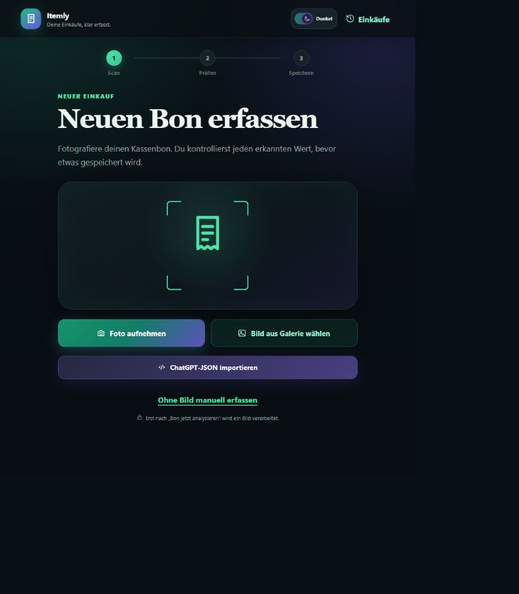

# Itemly

[](https://github.com/Kamitoad/itemly/actions/workflows/ci.yml)

Itemly turns paper receipts into a searchable purchase history. It's a self-hosted web app with a mobile-first German interface. Record what you bought, check the item prices against the printed total, and keep the receipt data and images on your own computer or home server.

The web app on `main` supports manual and AI-assisted receipt entry, editing saved receipts, and backups. It uses React, TypeScript, Vite, Express, and SQLite. A separate [experimental Android app](#android-prototype) uses Capacitor and stores receipts on the phone.

**Try it locally** with the [quick start](#quick-start). You'll land in the purchase overview. Select **Neuer Bon** to open the capture screen shown below.



## How it works

1. **Capture a receipt.** Enter items by hand, optionally attach a photo, or import receipt details as JSON. A configured AI provider can also extract details from a photo in the web app.
2. **Check the details.** Review or correct the merchant, currency, items, and amounts. Itemly flags uncertain results and shows the calculated total alongside the printed total. Confirming a receipt requires a known currency and balanced totals. Incomplete or unbalanced receipts can be saved as drafts with the discrepancy visible.
3. **Find and manage your purchases.** Search the history, edit a saved receipt or its items, and move receipts to the recoverable trash. The web app can export a single receipt as JSON, optionally with its image, or back up the entire collection.

## Quick start

Requires Node.js 24 or newer and pnpm 11.24.0.

```sh
pnpm install
pnpm dev
```

Open `http://localhost:5173` (the API runs at `http://localhost:8787`). To try the app without AI, choose **Neuer Bon → Ohne Bild manuell erfassen** and enter a sample purchase. On a phone connected to the same trusted Wi-Fi network, use the network URL printed by the development server.

To serve the built web app instead:

```sh
pnpm build
pnpm start
```

The app is then available at `http://localhost:8787`. The browser app can also be installed as a PWA and still uses the self-hosted server. Itemly has no login or access control. Run it on a private computer or trusted network, and do not expose it directly to the public internet. See the [security policy](SECURITY.md).

## Privacy and optional AI

The web app stores receipts in SQLite and keeps images on the computer running Itemly. It has no built-in analytics or telemetry. You choose whether to involve an external service.

- **Manual entry** requires no AI account or API key. Itemly does not send the receipt to an AI provider in this mode.
- **ChatGPT JSON import** requires no API key in Itemly. Select **ChatGPT-JSON importieren**, copy the provided prompt, and submit it with the photo in a separate ChatGPT chat. Paste the returned JSON into Itemly, which validates it and presents it for manual review. The upload to ChatGPT is your action and is subject to that service's terms and settings.
- **Optional web API extraction** sends the selected image to the configured OpenAI-compatible provider only after a notice and your explicit confirmation. The provider's terms govern how it handles the image.

For web API extraction, copy [`.env.example`](.env.example) to `.env` and set the provider credentials. Keep `.env` out of version control. The API key stays on the server.

```dotenv
OPENAI_API_KEY=
OPENAI_MODEL=gpt-4.1-mini
OPENAI_BASE_URL=https://api.openai.com/v1
```

See [privacy and data flow](PRIVACY.md) for details on storage, the trash, and external services.

## Back up and restore the web app

By default, Itemly stores the database at `./data/receipts.sqlite` and the original images in `./data/receipts/`. The `data/` directory and `.env` are excluded from Git. Download a full backup from the purchase overview or via `GET /api/backup`. The backup is unencrypted and may include sensitive receipt images and records in the trash.

Restore into an empty directory:

```sh
pnpm restore <backup.json> <empty-destination-directory>
```

Point `DATA_DIR` to the restored directory, start Itemly, and check that a saved purchase and its original image open correctly.

## Android prototype

The Capacitor development build is designed to capture, edit, save, and search receipts using the phone's app-private SQLite database and image storage. It includes user-initiated JSON backup export and restore into an empty database. Android system cloud backup is disabled. Exported files are unencrypted, and uninstalling removes the app's private data. The web and Android backup formats are separate. Migration from the web database to Android is pending.

- **Automated checks** exercise receipt review and persistence, including Android backup and restore logic with simulated Capacitor services. The Android CI workflow checks native compilation separately.
- **Build evidence** includes a signed development APK from the repository's [signed build workflow](https://github.com/Kamitoad/itemly/actions/runs/38185223476).
- **On a physical Samsung device**, [money-field editing was checked](https://github.com/Kamitoad/itemly/issues/23). The broader [device checklist](docs/ANDROID.md#real-device-acceptance-checklist) is still open, including offline capture and restart persistence, backup and restore, and data retention across signed updates.

For a local debug build, install Android Studio and its SDK, run `pnpm android:sync` and `pnpm android:open`, and deploy to a device. Follow the [Android guide](docs/ANDROID.md) for signing and backup instructions. Use the same persistent signing key for in-place preview updates and avoid switching between disposable PR APKs and durable builds. Keep another copy of important receipts while recovery and update testing is pending.

## Development and roadmap

Run `pnpm check` for TypeScript checks and Vitest, and `pnpm build` for the production build. GitHub CI runs both on pull requests and pushes to `main`. The suites cover receipt validation and totals, save and edit behavior, backups and restore, and React interactions in a simulated DOM. See [testing and verification](docs/TESTING.md) for the scope of automated and manual checks.

More detailed uncertainty indicators and easier editing of fees and deposits remain areas for improvement. The [web roadmap](https://github.com/Kamitoad/itemly/issues/8) and [phone-only roadmap](https://github.com/Kamitoad/itemly/issues/21) track further work, including advanced filters, category analysis, and optional encrypted backup destinations.

[Architecture](docs/ARCHITECTURE.md) · [Contributing](CONTRIBUTING.md) · [Changelog](CHANGELOG.md)

## License

[MIT License](LICENSE) © 2026 Chasan Moustafa.
